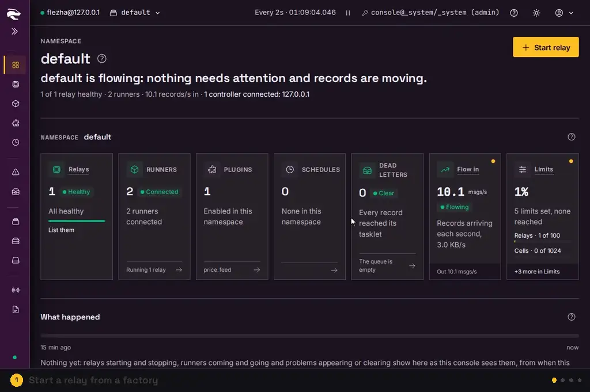

# Flezha Console

[](https://github.com/Flezha/flezha_console/actions/workflows/ci.yml)
[](https://github.com/Flezha/flezha_console/releases/latest)
[](https://hub.docker.com/r/flezha/flezha_console)
[](LICENSE)

The web console for [Flezha](https://github.com/Flezha/flezha) controllers.

> Flezha Console is an early release, made for Flezha 0.1.1: screens and settings may still
> change between versions until 1.0.



The console shows what your Flezha controllers are running and lets you act on it from a
browser: start and stop relays, watch records move through them, attach plugins, and see
in plain words what needs you. It keeps no copy of the controllers' data: every screen is
the controllers' own answer, read when you look.

## What you can do

- **See every relay's health** across namespaces and controllers, with problems ranked by
  how urgent they are and who has to act.
- **Start a relay** from any factory a runner serves, in a guided flow that shows the
  matching `flz` command before anything runs.
- **Watch a relay work:** its graph draws sources, tasklets, channels and plugins, with
  records moving through it as they pass, rates on every wire and each tasklet's Cells.
- **Tap any channel** to read its records live, or listen to a relay's inputs and outputs.
- **Attach and manage plugins**, with a form for each option the provider declares and
  the matching `flz plugin enable` command to copy.
- **Handle failures:** inspect, replay or drop dead letters, rewind a steps relay to a
  committed iteration, and read why a relay stopped.
- **Run the platform:** namespaces, quotas, access, schedules, the cluster's controllers and
  runners, logs and observability.

It works on a phone or tablet too.

## How it works

- **It talks to the controller over HTTPS.** The console calls the controller's HTTP API
  with a client certificate and a Flezha token. It joins no cluster and holds no cookie.
- **It acts as its token.** What you see and may do follows the role the token holds, and
  the controller judges every call. Each user can store a token of their own, so the audit
  log names the person rather than the console.
- **It keeps only its own accounts.** A Postgres database holds who can sign in. Everything
  about relays is read from the controllers.

## Get started

You need a running Flezha controller with its HTTP API enabled, a Postgres database, and a
token for the console. Run the console as the `flezha/flezha_console` Docker image, or as a
release archive from the [releases page](https://github.com/Flezha/flezha_console/releases)
for Linux x86_64 and macOS.

The Flezha documentation has a guide for each way to run it:

| Guide | How it runs |
|---|---|
| [Docker](https://github.com/Flezha/flezha/blob/main/docs/public/console/console_docker.md) | The console, its database and a controller in one Compose file |
| [Kubernetes](https://github.com/Flezha/flezha/blob/main/docs/public/console/console_kubernetes.md) | A deployment beside the controllers |
| [Bare metal](https://github.com/Flezha/flezha/blob/main/docs/public/console/console_bare_metal.md) | A release on your own machine, run by systemd |

[Running a release](docs/running.md) covers the archive and every setting it takes.

## Documentation

| Where to go | What you find |
|---|---|
| [Using the console](docs/guide.md) | The terms it uses, every screen, and how to get around |
| [Running a release](docs/running.md) | Downloading, checking, configuring and starting a release |
| [Development](docs/development.md) | The dev stack: two controllers, runners, the console and its tools |
| [Testing](docs/testing.md) | The two test layers and the rules every test follows |
| [How it is built](docs/architecture.md) | The design system, the relay graph, and how it talks to the controller |
| [Releasing](docs/releasing.md) | Building archives, CI, cutting a release and publishing the image |

## Development

The dev stack expects two sibling checkouts: [`flezha`](https://github.com/Flezha/flezha),
the controller, and [`flezha_stylebook`](https://github.com/Flezha/flezha_stylebook), the
design system.

```sh
$ mix assets.setup                                     # install the asset dependencies, once
$ docker compose -f docker-compose.dev.yml up --build  # two controllers, runners, the console
$ mix test                                             # the ExUnit suite
$ npm run e2e                                          # the browser suite, against the dev stack
```

Then sign in at http://localhost:4000 as `admin@flezha.com` with the password `admin`.
[Development](docs/development.md) and [Testing](docs/testing.md) have the details.

## License

Flezha Console is licensed under the [Mozilla Public License 2.0](LICENSE), the
same license as the Flezha controller. Use it and run it anywhere, commercially
too; if you distribute a modified copy, publish your changes to its files under
the same license. Flezha Console is provided "AS IS", without warranty of any kind
(MPL-2.0 §6-7). The license grants no trademark rights: a fork, derived work or
hosted service must not use the name "Flezha" or one confusingly similar.
